# First Signs

### Turning warning signs into completed care

[](https://nextjs.org/)
[](https://react.dev/)
[](https://supabase.com/)
[](https://www.typescriptlang.org/)
[](LICENSE)

**First Signs is a multilingual, mobile-first, multi-syndrome screening and care-navigation prototype for Bangladesh.** It currently supports English and Bangla and helps a person understand warning signs, find an appropriate care facility, create a verifiable referral, recover after a missed visit, and carry the journey through to independently confirmed attendance.

It can be used independently from home or with assistance from a participating pharmacy. Public-health teams receive privacy-safe grouped investigation signals—not patient records, diagnoses, or confirmed-outbreak claims.

> **Important:** First Signs does not diagnose any disease—including TB, dengue, malaria, leprosy, or pneumonia—prescribe treatment, or replace a qualified healthcare professional. It is a research and hackathon prototype. Its clinical rules and multilingual health content require qualified clinical and public-health review before real-world deployment.

- **Live prototype:** [first-signs.onrender.com](https://first-signs.onrender.com)
- **Full project narrative:** [PROJECT_STORY.md](PROJECT_STORY.md)
- **Product requirements:** [PRD.md](PRD.md)
- **Complete workflow guide:** [WORKFLOW_GUIDE.md](WORKFLOW_GUIDE.md)

<p align="center">
  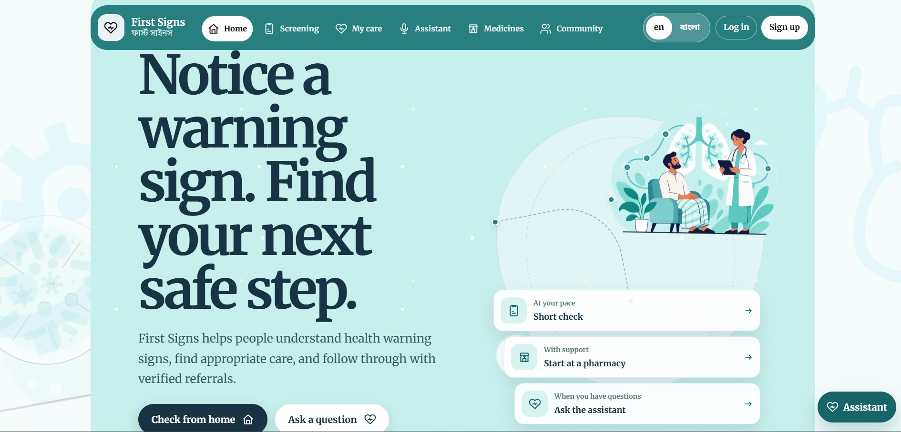
  <br><strong>Figure 1 — First Signs landing page.</strong> The redesigned entry presents the care-navigation purpose, language control, and self-use or pharmacy-assisted routes.
</p>

## The story behind First Signs

Imagine Maya, a garment worker and mother in Khulna. Her family may need help for a persistent cough, a fever after mosquito exposure, diarrhoea with dehydration warning signs, changes in skin sensation, or a child struggling to breathe. Like many people, their first practical stop may be a nearby pharmacy or a phone at home.

These concerns need different questions and may require different services. A pharmacy can help someone enter the care pathway, but it cannot perform the professional examination and testing needed to determine the cause.

This is where **First Signs** enters the journey. Maya can open it herself or use the pharmacy-assisted route. In a supported language, she can choose the relevant concern, consent, answer a small set of focused questions, receive fixed-rule urgency guidance, find an appropriate facility, and choose whether to create a referral. The same closed-loop journey applies across all five pathways. The pharmacy helps her reach the next step without diagnosing her. If she later reaches the intended facility, authorized staff independently confirm attendance—not a diagnosis or test result.

Read one complete example journey and the broader project story in [PROJECT_STORY.md](PROJECT_STORY.md).

## Why this project exists

The problem is larger than a lack of health information. People can be lost at every handoff between noticing a warning sign and reaching formal care:

| Care gap | First Signs response |
| --- | --- |
| A person is unsure whether a symptom needs attention | Short, pathway-specific screening with fixed safety rules |
| Advice does not provide a practical destination | Broad-area facility discovery and service-aware recommendations |
| A verbal recommendation is easy to lose | Portable referral ID, private token, and QR code |
| A person misses care because of work, distance, transport, fear, or stigma | Barrier-specific follow-up and a practical next action |
| A pharmacy helps but has no accountable handoff | A separate pharmacy-assisted path with independently verified milestones |
| Programme teams need early visibility without patient exposure | Anonymous, grouped, broad-area investigation signals |

The main innovation is not a prediction score. It is a **closed-loop care pathway**:

**Concern → safe guidance → appropriate facility → referral → attendance verification → follow-up**

## What First Signs does

### Five care-navigation pathways

1. Persistent cough or respiratory concern, including TB warning signs
2. Fever or mosquito-borne illness concern, including dengue and malaria warning signs
3. Diarrhoea or dehydration concern
4. Skin, sensation, or nerve concern, including leprosy warning signs
5. Child cough or difficult breathing, including pneumonia warning signs

The pathways do not diagnose TB, dengue, malaria, leprosy, pneumonia, or another illness. They check for defined warning signs, communicate urgency, and guide the person toward professional care.

No single disease defines the product. Each pathway has its own fixed rules and safety language, while all five use the same consent, navigation, referral, follow-up, and privacy framework. TB-specific audio research and facility data are clearly limited to the respiratory pathway.

### Core capabilities

- Self-use and pharmacy-assisted entry paths
- Persistent English/Bangla language control
- Fixed, deterministic, versioned safety rules
- Explicit consent and data-minimization explanations
- Broad-division facility recommendations across Bangladesh
- Optional transient browser GPS for route drawing; exact GPS is not persisted
- Unique referral IDs, private access tokens, and QR codes
- Independent care-facility attendance verification
- Private **My Care** journey and optional accounts
- Missed-referral follow-up with barrier-specific next actions
- Pharmacy-scoped workflow metrics and simulated credits
- Duplicate reward, reused-audio, referral-reuse, and unusual-volume safeguards
- Privacy-safe government/public-health aggregates and investigation signals
- Anonymous community feedback about barriers to care
- Multilingual Medicine Corner with general educational information
- Optional bounded health assistant, Telegram channel, reminders, and HeAR audio processing

### Mobile-first multilingual experience

English is the default language, and Bangla remains available through the persistent language toggle on every user-facing route. These are the two languages implemented in the current release; the language system is designed to add fully reviewed languages later. The application uses **Merriweather** for English and **Noto Sans Bengali** for Bangla, including forms, alerts, dashboards, loading states, validation, and mixed-language content.

The updated interface uses responsive layouts that preserve the same care hierarchy on desktop and mobile. The screenshots below document the current UI and important screening, safety, and assisted-access states.

## Updated product gallery

<table>
  <tr>
    <td width="50%" valign="top">
      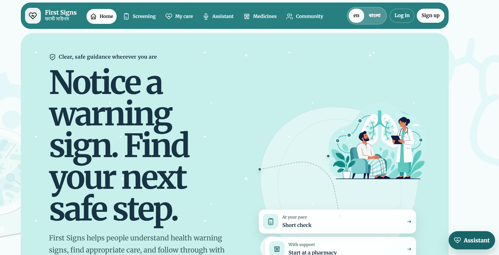
      <br><strong>Figure 2 — Landing and entry choices.</strong><br>
      The main experience presents the product promise and separates independent and pharmacy-assisted entry.
    </td>
    <td width="50%" valign="top">
      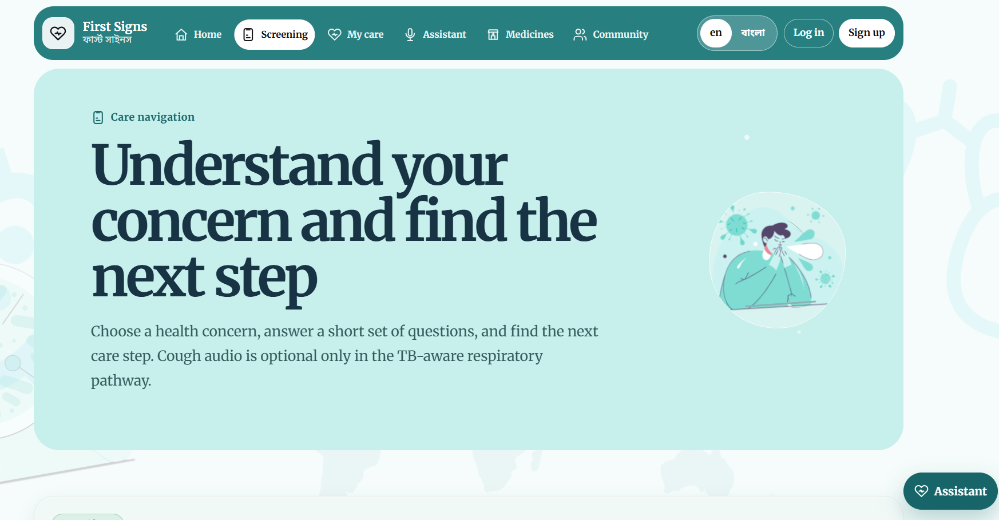
      <br><strong>Figure 3 — Screening introduction.</strong><br>
      The screening route explains that it provides care navigation rather than diagnosis before questions begin.
    </td>
  </tr>
  <tr>
    <td width="50%" valign="top">
      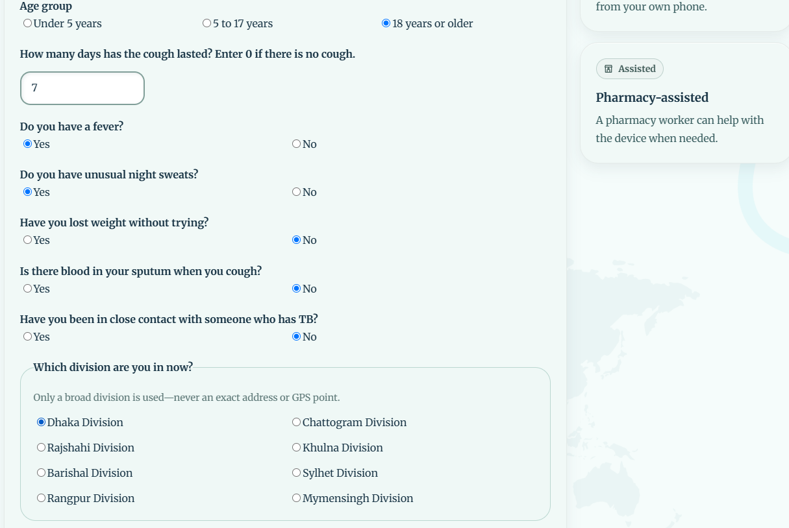
      <br><strong>Figure 4 — Pathway questionnaire.</strong><br>
      Structured answers feed the fixed safety rules while broad-area selection avoids storing an exact home location.
    </td>
    <td width="50%" valign="top">
      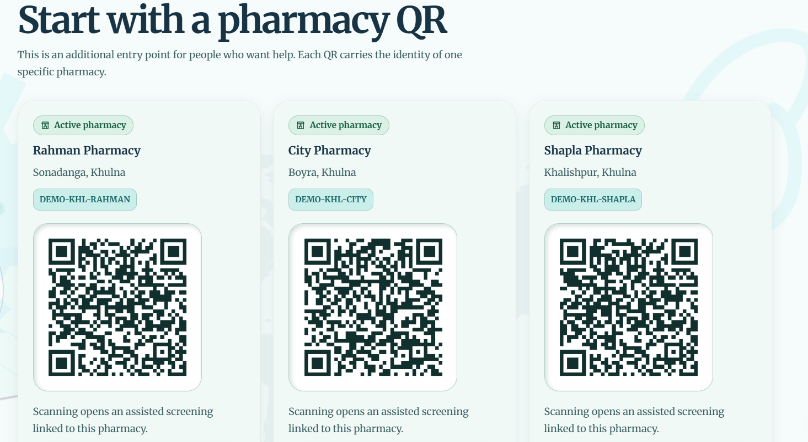
      <br><strong>Figure 5 — Pharmacy QR directory.</strong><br>
      A person can start an assisted journey through a clearly identified participating pharmacy.
    </td>
  </tr>
  <tr>
    <td width="50%" valign="top">
      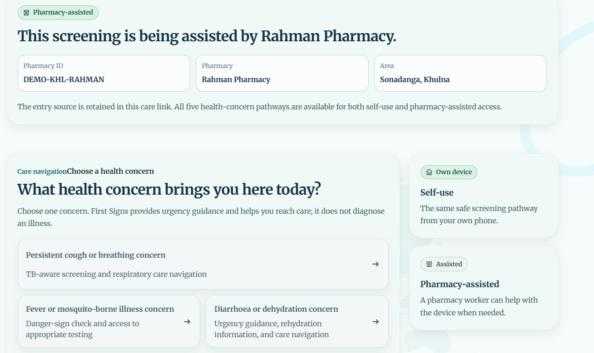
      <br><strong>Figure 6 — Pharmacy-assisted screening.</strong><br>
      The assisted route displays the pharmacy context while keeping every care pathway available.
    </td>
    <td width="50%" valign="top">
      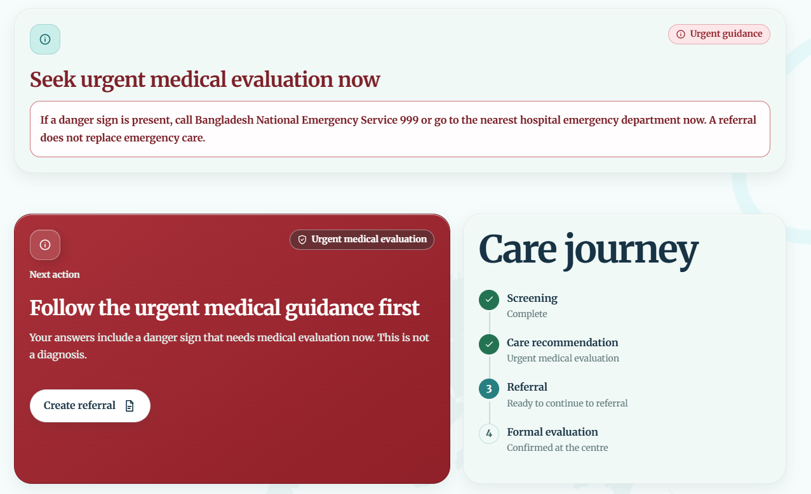
      <br><strong>Figure 7 — Urgent safety guidance.</strong><br>
      Danger signs take precedence and produce a prominent emergency action without claiming a diagnosis.
    </td>
  </tr>
  <tr>
    <td width="50%" valign="top">
      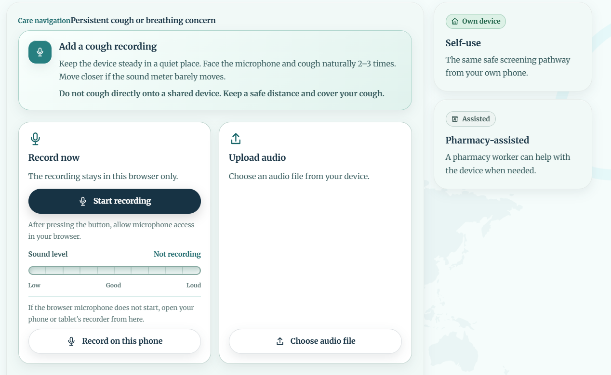
      <br><strong>Figure 8 — Optional cough-audio step.</strong><br>
      The respiratory pathway can record or upload audio while fixed symptom rules remain authoritative.
    </td>
    <td width="50%" valign="top">
      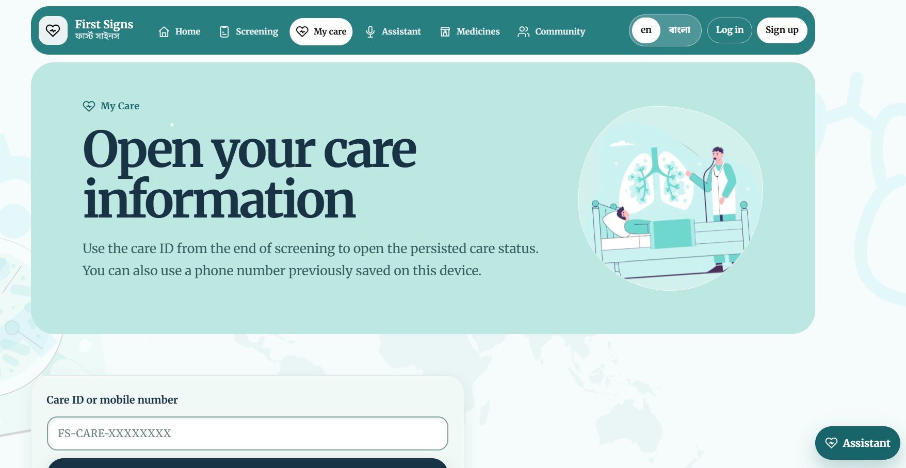
      <br><strong>Figure 9 — My Care access.</strong><br>
      A person can reopen a private journey using a care ID or a phone number previously saved on the device.
    </td>
  </tr>
  <tr>
    <td width="50%" valign="top">
      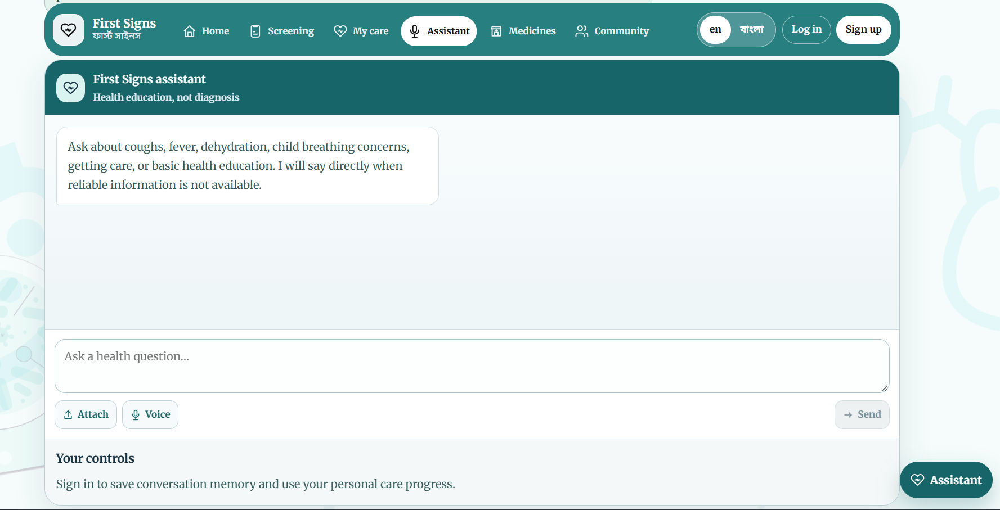
      <br><strong>Figure 10 — Bounded health assistant.</strong><br>
      The assistant answers general health and navigation questions but cannot diagnose, prescribe, or change safety results.
    </td>
    <td width="50%" valign="top">
      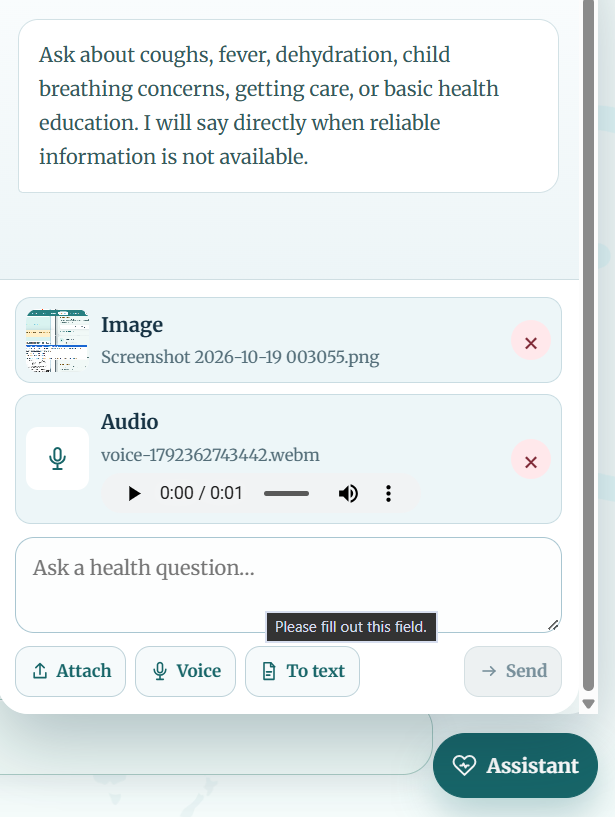
      <br><strong>Figure 11 — Assistant media input.</strong><br>
      Optional image and audio attachments provide transient context and are not retained as conversational memory.
    </td>
  </tr>
  <tr>
    <td width="50%" valign="top">
      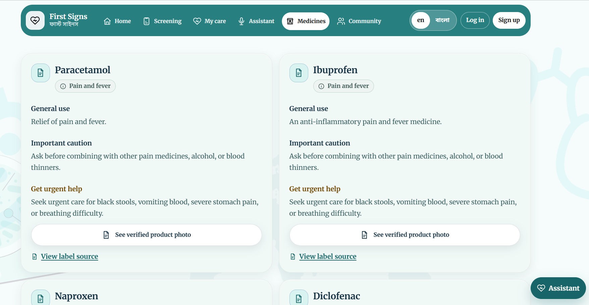
      <br><strong>Figure 12 — Medicine Corner.</strong><br>
      General information, cautions, and source links are provided without personal dosing or prescriptions.
    </td>
    <td width="50%" valign="top">
      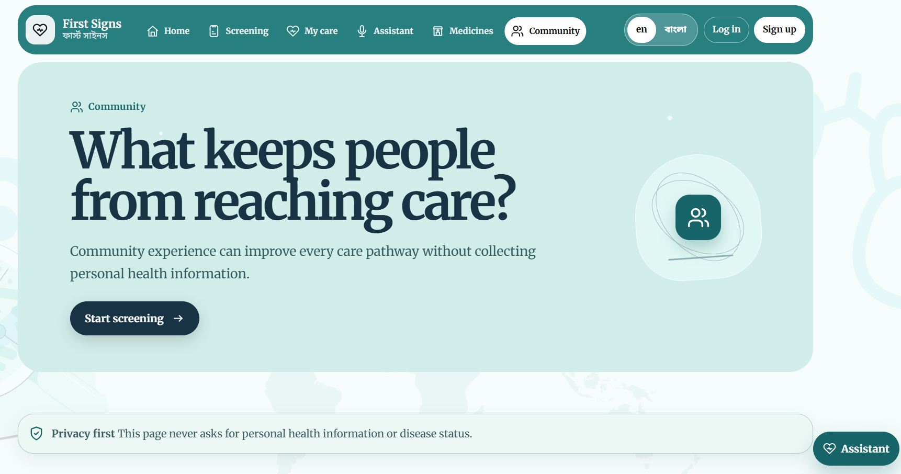
      <br><strong>Figure 13 — Community feedback.</strong><br>
      People can share structured barriers to care without providing identity, free text, or disease status.
    </td>
  </tr>
</table>

### Operations and alternate access

<table>
  <tr>
    <td width="50%" valign="top">
      
      <br><strong>Figure 14 — Guided screening.</strong><br>
      The screening flow gathers focused warning-sign information and directs people to an appropriate next step without diagnosing them.
    </td>
    <td width="50%" valign="top">
      
      <br><strong>Figure 15 — Telegram access.</strong><br>
      The optional Telegram channel gives people another way to begin a privacy-conscious care-navigation journey.
    </td>
  </tr>
  <tr>
    <td width="50%" valign="top">
      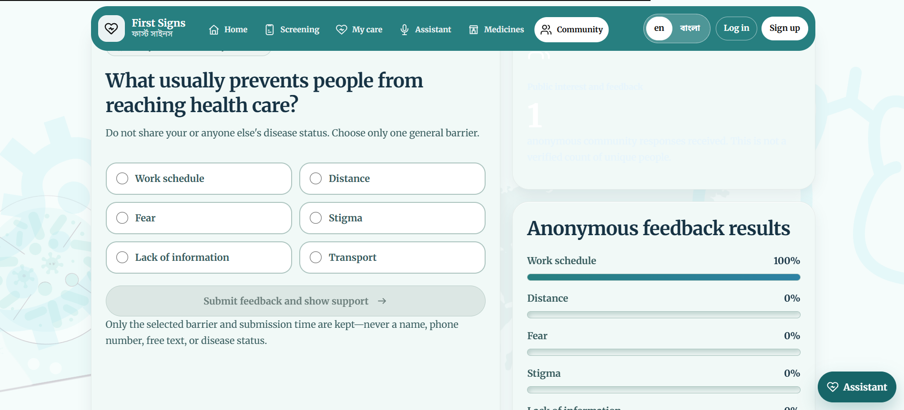
      <br><strong>Figure 16 — Community feedback.</strong><br>
      Structured, anonymous feedback captures barriers to care without collecting disease status or free-text personal details.
    </td>
    <td width="50%" valign="top">
      
      <br><strong>Figure 17 — Programme overview.</strong><br>
      Administrators see scoped, privacy-safe programme information rather than individual patient records.
    </td>
  </tr>
  <tr>
    <td width="50%" valign="top">
      
      <br><strong>Figure 18 — Grouped activity review.</strong><br>
      Aggregate views support operational review while preserving the separation between care navigation and diagnosis.
    </td>
    <td width="50%" valign="top">
      
      <br><strong>Figure 19 — Investigation signals.</strong><br>
      Broad-area signals are prompts for further investigation—not claims of a confirmed outbreak or clinical outcome.
    </td>
  </tr>
</table>

## General architecture

This view shows the product in the same order a person experiences it.

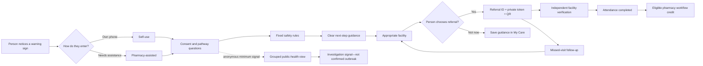

### Responsibility boundaries

| Participant | Receives | Does not control or receive |
| --- | --- | --- |
| Person seeking care | Their answers, guidance, facility, referral, and care status | Another person's journey or an app-generated diagnosis |
| Assisting pharmacy | Its own assisted-workflow aggregates and simulated credits | Self-use records, patient diagnosis, or attendance approval |
| Assigned facility staff | Referral lookup and one-time attendance confirmation | Pharmacy reward rules or an app-generated diagnosis |
| Government/public-health viewer | Grouped programme metrics and broad-area signals | Identity, raw answers, referral tokens, audio, or exact GPS |
| Optional AI/audio services | Minimum transient input needed for explanation or analysis | Authority to change the deterministic safety outcome |

## Technical architecture

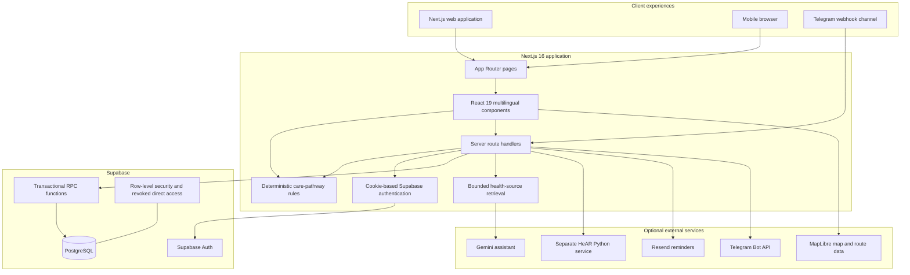

### Request and data flow

1. The client records whether the journey is self-use or tied to a validated pharmacy.
2. The person gives consent and completes every required answer for the chosen pathway.
3. Typed TypeScript rules calculate one language-neutral safety outcome.
4. The server validates the request again before calling a controlled PostgreSQL function.
5. Private screening/referral state and minimal anonymous care signals are stored separately.
6. Referral creation uses a public-facing referral ID plus an opaque private token.
7. Attendance verification checks authorization, intended facility, state, and prior use.
8. Pharmacy rewards are considered only for pharmacy-assisted journeys and remain separate from clinical outcomes.
9. Dashboard APIs return scoped aggregates rather than raw patient records.
10. Optional AI, audio, messaging, map, and email failures must not override the fixed safety result.

## Safety, privacy, and incentive design

### Safety rules

- The application communicates screening and navigation, never diagnosis.
- Urgent danger signs take precedence over every other outcome.
- Invalid or incomplete answers do not produce a safety outcome.
- AI cannot create, downgrade, or reverse a fixed recommendation.
- Audio analysis is optional and cannot rule out illness or prevent referral.
- Fever symptoms are not used to guess dengue rather than malaria.
- The child pathway does not label a child as having pneumonia.
- Attendance completion means formal evaluation started—not diagnosis, test result, or treatment outcome.

### Privacy rules

- Government and public views receive grouped signals only.
- Exact home addresses and exact patient GPS are not stored in screening, referral, analytics, or hotspot records.
- Raw cough audio and embeddings are transient in the documented workflow.
- Telegram continuity uses a one-way channel identifier instead of storing raw chat IDs.
- Reminder emails are generic and must not contain symptoms, referral IDs, facility details, or diagnostic wording.
- Referral tokens, API secrets, staff PINs, and server credentials must never be logged or exposed through `NEXT_PUBLIC_` variables.

### Incentive safeguards

- Self-use journeys never create pharmacy rewards.
- A pharmacy cannot verify its own referral.
- Rewards represent workflow milestones, never a positive disease result.
- Referral completion is one-time and idempotent.
- Repeated patient rewards can be blocked without blocking care.
- Reused audio creates a review warning, not a fraud verdict.
- Unusual pharmacy activity can hold only new simulated rewards for review.

## Technology stack

| Layer | Technology | Purpose |
| --- | --- | --- |
| Web application | Next.js 16 App Router, React 19 | Pages, server rendering, route handlers, and interactive flows |
| Language | TypeScript in strict mode | Shared types and testable rules |
| Database and authentication | Supabase, PostgreSQL, `@supabase/ssr` | Accounts, records, transactional workflow functions, and scoped access |
| Maps | MapLibre GL JS | Facility maps, routes, and privacy-safe geographic views |
| Motion | Motion for React | Restrained transitions with reduced-motion support |
| Referrals | `qrcode`, `jsqr` | QR generation and local QR-image parsing |
| Email | Resend | Optional generic reminders |
| AI | Gemini API | Optional bounded explanations based on approved sources |
| Messaging | Telegram Bot API | Optional alternate entry channel |
| Audio research | Google HeAR in a separate Python service | Optional transient cough-like-signal processing |
| Testing | Node test runner and Playwright Core | Unit, integration, browser, language, and responsive checks |

## Application routes

### User-facing routes

| Route | Purpose |
| --- | --- |
| `/` | Landing page and entry choices |
| `/screen?source=self` | Independent screening entry |
| `/screen?source=pharmacy&pharmacy=<id>` | Validated pharmacy-assisted entry |
| `/care` | Private My Care journey, facility finder, and follow-up |
| `/referral` | Referral ticket and QR view |
| `/verify` | Assigned care-facility attendance verification |
| `/pharmacy` | Pharmacy-scoped aggregate workspace |
| `/dashboard` | Government/public-health aggregate workspace |
| `/community` | Anonymous barriers-to-care feedback |
| `/account` | Optional patient account and role-aware workspace |
| `/assistant` | Bounded multilingual health assistant |
| `/medicines` | Multilingual general medicine education |

### Server endpoints

The `app/api/` directory contains server-only endpoints for screenings, care state, signals, referrals, verification, follow-up, role-scoped dashboards, accounts, authentication, reminders, community feedback, health assistance, medicine-source lookup, audio processing, admin invitations, and Telegram webhooks.

Sensitive database operations use server-side credentials. The Supabase secret or legacy service-role key must never be sent to the browser.

## Getting started

### Prerequisites

- [Node.js 20.9 or newer](https://nextjs.org/docs/app/getting-started/installation)
- npm, included with Node.js
- A [Supabase](https://supabase.com/) project for persisted workflows
- Git
- Optional: a Supabase CLI installation or `npx supabase`
- Optional: Python 3.11 for the separate HeAR service

### 1. Clone and install

```bash
git clone <your-repository-url>
cd First-Signs
npm install
```

`npm install` also copies the MapLibre worker used by the application.

### 2. Create the environment file

macOS/Linux:

```bash
cp .env.example .env.local
```

PowerShell:

```powershell
Copy-Item .env.example .env.local
```

Open `.env.local` and replace placeholders with your own values. **Never commit `.env.local`, paste its contents into an issue, or expose a secret using the `NEXT_PUBLIC_` prefix.**

### 3. Configure the minimum environment

The persisted screening, referral, care, pharmacy, and dashboard workflows require:

```dotenv
SUPABASE_URL=https://your-project.supabase.co
SUPABASE_SECRET_KEY=your-server-only-secret-key

NEXT_PUBLIC_SUPABASE_URL=https://your-project.supabase.co
NEXT_PUBLIC_SUPABASE_PUBLISHABLE_KEY=your-browser-safe-publishable-key

NEXT_PUBLIC_APP_URL=http://localhost:3000
```

Use Supabase's current publishable and secret keys when available. `SUPABASE_SERVICE_ROLE_KEY` and `NEXT_PUBLIC_SUPABASE_ANON_KEY` remain supported by the code as legacy fallbacks.

### Environment-variable reference

| Variable | Level | Used for |
| --- | --- | --- |
| `SUPABASE_URL` | Required | Server-side Supabase origin |
| `SUPABASE_SECRET_KEY` | Required | Server-only privileged database access |
| `SUPABASE_SERVICE_ROLE_KEY` | Legacy alternative | Fallback for `SUPABASE_SECRET_KEY` |
| `NEXT_PUBLIC_SUPABASE_URL` | Required for accounts | Browser-safe Supabase origin |
| `NEXT_PUBLIC_SUPABASE_PUBLISHABLE_KEY` | Required for accounts | Browser-safe Supabase publishable key |
| `NEXT_PUBLIC_SUPABASE_ANON_KEY` | Legacy alternative | Fallback browser key |
| `NEXT_PUBLIC_APP_URL` or `APP_URL` | Recommended | Stable QR, callback, and webhook origin |
| `TB_CENTRE_STAFF_PIN` | Optional prototype control | Temporary verification access separation |
| `RESEND_API_KEY` | Optional | Generic reminder email delivery |
| `REMINDER_FROM_EMAIL` | Optional | Sender address for reminders |
| `REMINDER_CRON_SECRET` | Optional | Protects the reminder-send endpoint |
| `GEMINI_API_KEY` | Optional | Bounded health-assistant generation |
| `GEMINI_MODEL` | Optional | Gemini model selection |
| `HEALTH_ASSISTANT_WEB_RETRIEVAL` | Optional | Refreshes approved-source excerpts when `true` |
| `HEAR_SERVICE_URL` | Optional | Reachable URL for the separate audio service |
| `HEAR_SERVICE_TOKEN` | Optional | Shared server-only bearer token for HeAR |
| `HEAR_TRIAGE_CLASSIFIER_PATH` | Research only | Approved investigational triage artifact |
| `TBSCREEN_DATA_TERMS_CONFIRMED` | Research only | Explicit confirmation of external dataset terms |
| `MESSAGING_ID_SECRET` | Optional | HMAC secret for one-way messaging identifiers |
| `TELEGRAM_BOT_TOKEN` | Optional | Telegram Bot API credential |
| `TELEGRAM_WEBHOOK_SECRET` | Optional | Authenticates Telegram webhook requests |
| `TELEGRAM_WEBHOOK_SECRET_PREVIOUS` | Optional | One-deployment secret-rotation overlap |
| `TELEGRAM_BOT_USERNAME` | Optional | Generates Telegram entry links |

The authoritative template is [.env.example](.env.example). Check configuration without printing secret values:

```bash
npm run check:config
```

### 4. Prepare Supabase

This repository uses ordered SQL migrations in `supabase/migrations/`. Use a fresh development project when reproducing the prototype.

```bash
npx supabase init
npx supabase login
npx supabase link --project-ref <your-project-ref>
npx supabase migration list
npx supabase db push
```

Review the linked project and pending migrations before `db push`. Do not run destructive reset commands against production. Supabase documents the current CLI workflow in its [local-development guide](https://supabase.com/docs/guides/local-development/cli-workflows).

For account callbacks, add the appropriate local and deployed URLs to the Supabase Auth redirect allow list, for example:

```text
http://localhost:3000/auth/callback
https://your-domain.example/auth/callback
```

The project also includes a recovery email template at `supabase/templates/recovery.html`.

### 5. Start the application

```bash
npm run dev
```

Open [http://localhost:3000](http://localhost:3000).

For a production-mode check:

```bash
npm run build
npm run start
```

## Optional integrations

### Gemini health assistant

Set `GEMINI_API_KEY` and optionally `GEMINI_MODEL`. The assistant is an education and navigation layer only. It cannot determine screening outcomes, diagnose, prescribe, or override urgent guidance.

### Telegram

Set the Telegram and messaging variables from `.env.example`, deploy the application to a public HTTPS origin, then run:

```bash
npm run telegram:webhook:set
npm run telegram:webhook:status
```

Webhook requests are authenticated with `TELEGRAM_WEBHOOK_SECRET`. Do not place the secret or bot token in URLs, logs, screenshots, or client-side variables.

### Generic reminders

Set `RESEND_API_KEY`, `REMINDER_FROM_EMAIL`, and `REMINDER_CRON_SECRET`. Reminder content must remain generic and must not contain symptoms, referral details, facility information, or diagnostic wording.

### HeAR audio service

The optional Python audio service runs separately from Next.js. Follow [hear-service/README.md](hear-service/README.md) for model terms, installation, service authentication, research boundaries, and deployment details.

The web workflow must remain usable when HeAR is unavailable. Raw audio and embeddings are not retained by the documented workflow.

## Project structure

```text
First-Signs/
├── app/                         # Next.js pages, layouts, and server API routes
│   ├── api/                     # Authenticated and public server endpoints
│   ├── account/                 # Optional accounts and role-aware workspace
│   ├── care/                    # My Care, facilities, routes, and follow-up
│   ├── screen/                  # Shared multi-pathway screening entry
│   ├── referral/                # Referral ticket and QR view
│   ├── verify/                  # Independent attendance verification
│   ├── pharmacy/                # Pharmacy aggregate workspace
│   ├── dashboard/               # Government/public-health aggregates
│   ├── assistant/               # Bounded health assistant
│   ├── medicines/               # Medicine Corner
│   └── community/               # Anonymous barrier feedback
├── components/                  # Multilingual UI and complete workflow components
├── lib/                         # Safety rules, pathway logic, auth, data, and services
├── public/                      # Static artwork and vendored MapLibre workers
├── docs/images/                 # Repository-owned README screenshots
├── scripts/                     # Unit, integration, browser, and quality checks
├── supabase/
│   ├── migrations/              # Ordered PostgreSQL schema and workflow changes
│   ├── tests/                   # Transactional database regression tests
│   └── templates/               # Supabase Auth email templates
├── hear-service/                # Optional authenticated Python audio service
├── PRD.md                       # Product source of truth
├── PROJECT_STORY.md             # Judge-friendly narrative and project story
├── WORKFLOW_GUIDE.md            # Plain-language end-to-end workflows
├── IMPLEMENTATION_GUIDE.md      # Detailed implementation and validation guide
└── .env.example                 # Safe configuration template—no real secrets
```

## Important implementation modules

| Module | Responsibility |
| --- | --- |
| `lib/care-pathways.ts` | Five pathway definitions, validation, and deterministic outcomes |
| `lib/safety-rules.ts` | Original respiratory/TB safety-rule boundary |
| `components/screening-flow.tsx` | Consent, questions, audio choice, outcome, and referral choice |
| `lib/care-session.ts` | Local care-session shape and self/pharmacy storage separation |
| `app/api/screenings/route.ts` | Server-side screening validation and persistence |
| `app/api/referrals/route.ts` | Referral validation and transactional creation |
| `app/api/referrals/verify/route.ts` | Protected lookup and attendance confirmation |
| `lib/auth.ts` | Cookie-based auth and role/scope resolution |
| `lib/supabase-server.ts` | Server-only database RPC transport and retry policy |
| `lib/health-rag.ts` | Approved-source retrieval for the assistant |
| `lib/messaging-server.ts` | Shared, idempotent messaging workflow |
| `lib/hear-audio.ts` | Optional authenticated HeAR service boundary |

## Database model

The migration history builds the following main concepts:

- `patients`: private prototype patient identifiers and consent state
- `screenings`: source, broad area, answers, outcome, pathway version, and audio-hash metadata
- `referrals`: referral ID, opaque token, intended facility, and attendance state
- `followups`: missed-visit barrier and next-action state
- `pharmacies`: validated assisted-access points
- `tb_centers`: listed care facilities and service metadata
- `rewards`: simulated pharmacy workflow credits
- `care_signals`: minimum anonymous pathway-level area signals
- `staff_memberships`: invite-only role and scope assignments
- Account profiles, patient links, reminders, assistant preferences/messages, community feedback, and messaging-session tables

Row-level security is enabled on exposed tables. Sensitive workflows are performed by validated server routes and narrowly granted database functions. Direct client access must never use the Supabase secret/service-role key.

## Testing and quality checks

### Fast checks

```bash
npm run lint
npx tsc --noEmit
npm run build
npm run check:config
```

### Focused unit tests

| Command | Coverage |
| --- | --- |
| `npm run test:config` | Environment configuration states |
| `npm run test:safety` | Fixed respiratory safety precedence and validation |
| `npm run test:pathways` | All five care pathways |
| `npm run test:fraud-hash` | Audio hashing and duplicate-signal boundary |
| `npm run test:ai` | AI claim and safety guardrails |
| `npm run test:medicines` | Medicine catalogue integrity and boundaries |
| `npm run test:messaging` | Messaging authentication, privacy, and workflow rules |

### Browser and workflow checks

| Command | Coverage |
| --- | --- |
| `npm run test:pathways-browser` | Five pathways in English and Bangla on mobile |
| `npm run test:care` | My Care experience |
| `npm run test:care-persistence` | Persisted care status |
| `npm run test:finder` | Facility finding and maps |
| `npm run test:referral` | Referral creation and ticket view |
| `npm run test:verify` | Protected verification and completion |
| `npm run test:pharmacy` | Pharmacy dashboard and incentive boundaries |
| `npm run test:dashboard` | Government aggregates and hotspot language |
| `npm run test:community` | Anonymous barrier feedback |
| `npm run test:integration` | Deterministic core journey integration |
| `npm run test:assistant-browser` | Health-assistant interface |
| `npm run test:account-browser` | Account interface and role entry |
| `npm run test:medicines-browser` | Medicine Corner interface |
| `npm run test:hear-browser` | Optional audio UI and fallback |

Many browser scripts use controlled API fixtures so the UI, language, and safety states are reproducible. Database tests and live integration checks should also be run against an explicitly configured development environment.

The complete Windows quality suite is:

```powershell
npm run test:final
```

It expects a configured `.env.local`, a linked development database, Chrome, and the local HeAR prerequisites documented by the implementation guide.

## Suggested judge demonstration

1. Open the landing page and show the multilingual framework by switching between the currently supported English and Bangla.
2. Start a self-use pathway and show consent, focused questions, and fixed-rule guidance.
3. Show that urgent language does not claim a diagnosis.
4. Select a facility and create a referral with its QR code.
5. Open My Care and demonstrate missed-visit barrier support.
6. Use the verification workspace to explain independent attendance confirmation.
7. Repeat the entry through a pharmacy-assisted link.
8. Show that only the pharmacy-assisted journey is eligible for simulated credits.
9. Repeat the pathway choice to show that respiratory concerns, fever, diarrhoea/dehydration, skin or nerve concerns, and child breathing concerns each have their own fixed rules and non-diagnostic guidance.
10. Open the government dashboard and explain why its pathway-specific signals are grouped investigation prompts—not confirmed outbreaks.
11. Close with the architecture: AI, Telegram, audio, maps, and email add access or explanation, while fixed rules remain in control of safety.

## Deployment notes

The Next.js application can be deployed to a Node-compatible hosting service.

Typical commands:

```text
Build: npm install && npm run build
Start: npm run start
```

Deployment requirements:

- Add server-only secrets through the hosting provider's protected environment settings.
- Set `NEXT_PUBLIC_APP_URL` to the final HTTPS origin and rebuild.
- Add the deployed `/auth/callback` URL to Supabase Auth redirects.
- Keep the Supabase secret/service-role key server-only.
- Use a separate service for HeAR; production Next.js cannot reach a Python service through its own `localhost`.
- Configure Telegram only after the HTTPS origin is stable.
- Run `npm run check:config`, a production build, and the relevant live workflows after deployment.

## Prototype limitations

- First Signs has not received clinical approval for public healthcare deployment.
- The multilingual framework currently implements English and Bangla; both languages' questions and safety messages require independent clinical and language review before public clinical use.
- Listed facility availability should be confirmed before travel and regularly re-verified.
- Pharmacy credits are illustrative; no real-payment programme is implemented.
- Human-support escalation is represented as a workflow state and does not automatically notify a real support team.
- The temporary TB-centre PIN is prototype access separation, not production identity management.
- Optional AI and acoustic outputs depend on external configuration and are intentionally non-diagnostic.
- Acoustic TB-triage research requires separately authorized clinical data, documented terms, calibration, subgroup evaluation, and external validation.
- A production rollout would require threat modelling, penetration testing, monitoring, incident response, data-retention governance, accessibility review, clinical governance, and regulatory assessment.

## Roadmap

- Independent clinical and Bangla-language review
- Usability studies with patients, pharmacy staff, and facility staff
- Regularly verified nationwide facility data
- Stronger low-bandwidth and offline-friendly behavior
- Production staff identity and organization management
- Partner-governed pharmacy incentive pilot
- Measured referral acceptance, attendance, and barrier-resolution outcomes
- Stronger privacy thresholds for real public-health reporting
- Additional approved health-education sources
- Carefully governed external evaluation of any investigational acoustic model

## Documentation

| Document | Use it for |
| --- | --- |
| [PRD.md](PRD.md) | Authoritative product requirements and non-negotiable boundaries |
| [PROJECT_STORY.md](PROJECT_STORY.md) | Detailed Devpost/judge narrative |
| [WORKFLOW_GUIDE.md](WORKFLOW_GUIDE.md) | Every entry, success, failure, and recovery path in plain language |
| [IMPLEMENTATION_GUIDE.md](IMPLEMENTATION_GUIDE.md) | Build order, validation details, evidence, and operations |
| [hear-service/README.md](hear-service/README.md) | Optional audio-service setup and research limitations |
| [hear-service/DATASETS.md](hear-service/DATASETS.md) | Dataset provenance, licences, and permitted use |
| [hear-service/model/MODEL_CARD.md](hear-service/model/MODEL_CARD.md) | Current cough-presence classifier details |

## Contributing

Before changing product behavior:

1. Read [PRD.md](PRD.md); it is the source of truth.
2. Preserve equivalent English and Bangla meaning.
3. Keep safety decisions deterministic and independent from AI.
4. Keep self-use and pharmacy-assisted incentives separate.
5. Never expose patient information in public-health views.
6. Add or update focused tests.
7. Run the relevant success, failure, mobile, language, and font checks.
8. Document anything intentionally mocked or incomplete.

Do not commit `.env` files, access tokens, model snapshots, patient data, raw audio, or generated local artifacts.

## License

The application source is available under the [MIT License](LICENSE).

External datasets, model weights, health guidance, maps, and third-party services retain their own licences and terms. The repository licence does not grant rights to redistribute external medical data or model artifacts.

## Maintainer

Created and maintained by **Tawhidul Hasan** for the First Signs hackathon prototype.

---

**First Signs does not try to replace the healthcare system. It helps people reach it.**
